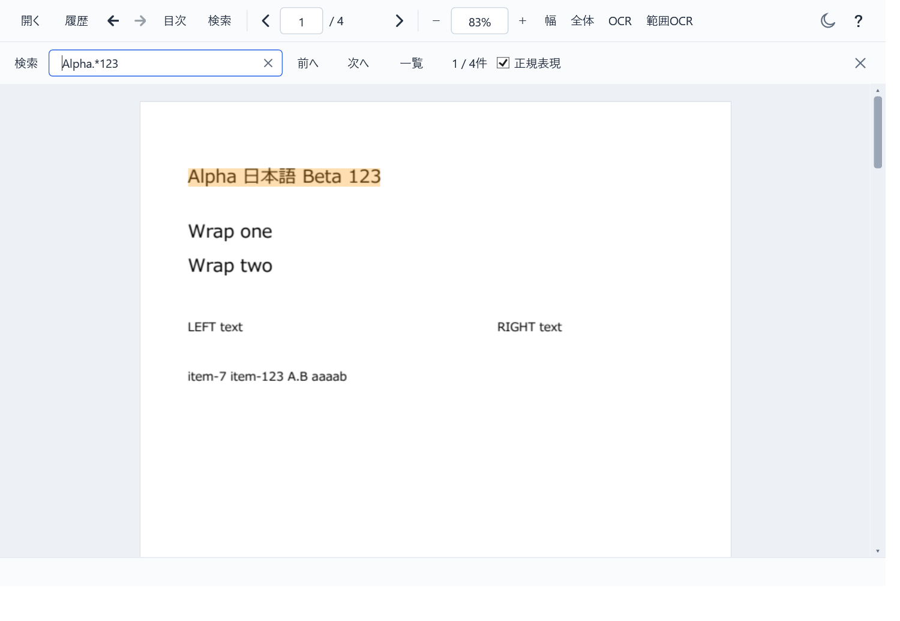

# LightViewR v0.3.13 の配布確認

PDFの検索一致を行ごとの連続した矩形にし、検索件数の右に「正規表現」チェックを追加しました。初期OFFで通常の文字列検索を維持します。

配布EXEに含まれるReadyToRun DLLと同梱ファイルで、検索機能140項目、配置・撮影27項目、既存検索操作51項目、PDF選択21項目（計239項目）を検証し、すべて成功しました。開発ビルドだけを確認した結果ではありません。

- PDFの和英混在・空白を含む一致を1矩形で表示。複数行は行別、離れた列は別矩形にし、選択色と現在結果の区別を維持。
- 4方向の回転、125%ズーム、100/150/200%のシミュレートDPIで確認。
- PDF、TXT、LOG、JSON、XML、INI、CSV、TSV、Markdown、HTMLで正規表現ON/OFF、可変長一致、前後移動、無効式、ゼロ幅、連続変更、閉じる／再表示を確認。
- 幅800/1000で長い件数・進捗文・エラー表示とチェックが重ならないこと、タブ順と全文ツールチップを確認。
- 病的な式の時間制限、取消・新検索への切替、式長・件数上限を確認。18万行の合成ログで後方の行への正規表現検索と範囲選択を確認。

ZIPを展開した実EXEでPDF・テキスト・表・Markdown・HTMLの起動と通常終了を確認しました。PDFiumとWebView2ローダーは同梱の`_support`から読み込み、不要な自己展開はありません。専用フォルダで履歴と読書位置の保存も確認しました。

検証は専用Win32デスクトップ、Idle優先度、ソフトウェア描画、WebView2 GPU無効で順次実施しました。利用者の入力デスクトップ・文書・設定は変更していません。GitHub Actionsを使わずローカルでビルドしています。

- 配布ファイル: `LightViewR-v0.3.13.zip`（8,534,415 bytes、229ファイル）
- ZIPのSHA-256: `ee4103921e47edbaf09adeca40d022e70b5c23d22d4773233ef84ca0d16d53ae`
- EXEのSHA-256: `acddbbeb53de7f7c23c8221799507a5ffe9ee860d7c7aa878e5a18e8af3352da`
- 同梱マニフェスト228項目のハッシュがすべて一致。個人設定、開発者のローカルパス、.NET Runtime、WebView2 Runtimeは含みません。
- 必要環境: Windows x64 + .NET 10 Desktop Runtime x64。Markdown/HTMLにはWebView2 Runtimeも必要です。

正規表現は.NET構文で初期設定は大小文字を区別しません。`(?-i)`で区別できます。検索単位（PDFページ、テキスト行、表のレコード、Markdown/HTMLブロック）をまたぐ一致は対象外です。ゼロ幅一致とサロゲートペアを分断する一致は強調しません。式4,096文字、1回の照合100ms、照合時間累計2秒、一致100,000件が上限です。

物理マウス／実モニター間のDPI変更、利用者のPDF、追加OCR、Windows 10実機は未確認です。PDFの行順はPDFiumの抽出に従います。正規表現モードで追記・再読込すると全検索をやり直すため、巨大な追記ログでは通常検索より作業量が増える場合があります。

[v0.3.13をダウンロード](https://github.com/mezon-web/LightViewR-Releases/releases/tag/v0.3.13)
