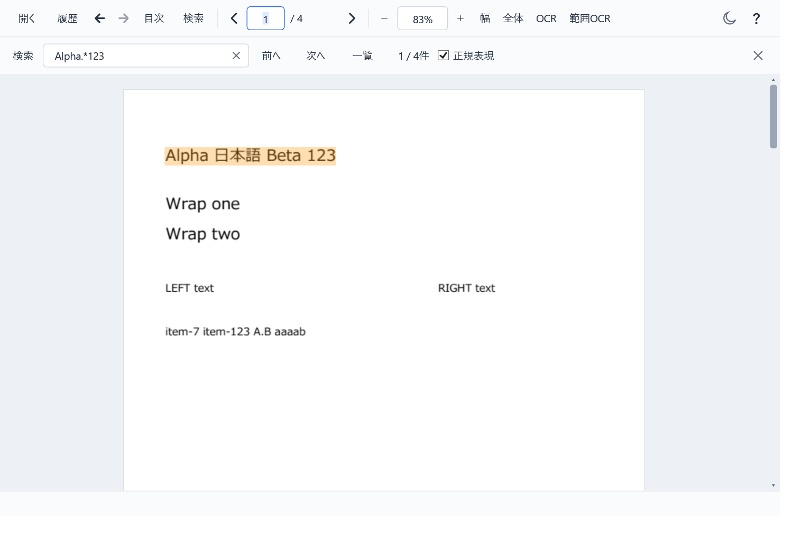

# LightViewR v0.3.14 の配布確認

ページ番号・倍率・検索欄などで選択した文字が見えなくなる問題を修正しました。選択背景を文字の後ろに描き、文字を半透明にせず、ライト・ダークの両テーマで可読性を保ちます。PDF検索ヒットの矩形には四辺1.5 DIPの余白を追加しました。

配布EXEに含まれるReadyToRun DLLと同梱ファイルで、入力欄29項目、検索150項目、PDF本文選択21項目（計200項目）に成功しました。開発ビルドだけを確認した結果ではありません。配布版の実画面も取得しました。

- ページ番号・倍率・検索欄の全選択／部分選択、フォーカスあり／なし、明暗テーマで選択文字を確認。パスワード欄の伏字も確認。
- 単一EXEの実行設定に背景描画方式が含まれ、選択背景の不透明度は1、文字色は通常時と同じであることを実画素で確認。
- 検索矩形の余白は四辺1.5 DIP。0／90／180／270度の回転、50／100／200%ズーム、100／150／200%のシミュレートDPIで確認。複数行・離れた列の矩形は分離したまま。
- PDF、TXT、LOG、JSON、XML、INI、CSV、TSV、Markdown、HTMLの通常検索・正規表現検索、前後移動、無効式、ゼロ幅、タイムアウト、取消を確認。
- 本文の日本語・複数行・回転ページの選択、コピー範囲、検索強調より選択色を優先する動作を確認。

ZIPを展開した実EXEでPDF・テキスト・表・Markdown・HTMLの起動と通常終了を確認しました。PDFiumとWebView2ローダーは同梱の `_support` から読み込み、起動時の自己展開はありません。専用フォルダで履歴・読書位置の保存と通常のウィンドウ終了も確認しました。

検証は専用Win32デスクトップ、Idle優先度、ソフトウェア描画、WebView2 GPU無効で順次実施しました。利用者の入力デスクトップ・文書・設定は変更していません。GitHub Actionsを使わずローカルでビルドしています。

- 配布ファイル: `LightViewR-v0.3.14.zip`（8,534,356 bytes、229ファイル）
- ZIPのSHA-256: `2736ee95478a0c581c33c67e42e024b580146d77216f16235de7e0a03a29f8cb`
- EXEのSHA-256: `8525810ddce8b48aef0fa99bc0d9515add218bb852ec6534a96734e94bb10bd7`
- 同梱マニフェスト228項目のハッシュがすべて一致。個人設定、開発者のローカルパス、.NET Runtime、WebView2 Runtimeは含みません。

物理マウス／キーボード操作、実モニター間のDPI変更、高コントラスト、IME変換中、ウィンドウ全体の非アクティブ化、利用者の実文書、Windows 10実機は未確認です。フォーカスなしの入力欄は同じウィンドウ内の別コントロールへの移動で確認しました。余白はDIP基準で、OS拡大率に応じた物理ピクセル数は変化します。

[v0.3.14をダウンロード](https://github.com/mezon-web/LightViewR-Releases/releases/tag/v0.3.14)
