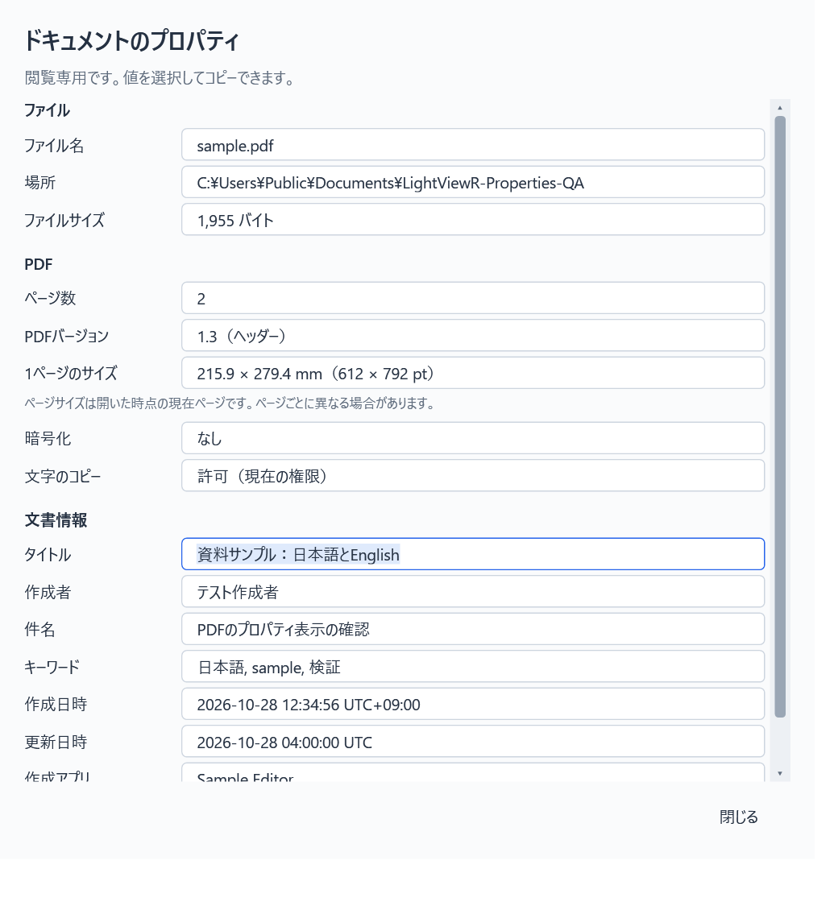

# LightViewR v0.3.15 の配布確認

PDFのドキュメントプロパティを追加しました。右上のテーマ切り替えの左に「プロパティ」があり、読み込み済みのPDFでだけ有効になります。ファイル情報・ページ数・PDFヘッダーバージョン・現在ページのサイズ・文書情報・暗号化・現在の文字コピー権限を閲覧専用で表示します。

配布EXEから取り出した実際のReadyToRun DLLで、以下の **251項目** に成功しました。開発用DLLだけを確認した結果ではありません。

| 検証対象 | 成功数 |
| --- | ---: |
| プロパティ、日時、画面の開閉 | 45 |
| 通常検索・正規表現・PDF検索矩形 | 150 |
| 入力欄・パスワード欄の選択可読性 | 29 |
| 検索件数・正規表現チェックの配置とキーボード順 | 27 |

- 日本語を含む8種の文書情報、未設定・文書情報辞書なし、不正な日時・省略された日時・タイムゾーン、上限を超える値を確認しました。
- サイズが混在するPDFでは、現在ページの寸法を表示し、閉じて開き直すと移動先のページの値を取得します。全ページ共通の寸法とは表示しません。
- 暗号化PDFで閲覧用・所有者パスワードによる現在の文字コピー権限を確認しました。権限の変更や制限解除は行いません。
- 読み込み前・PDF以外の無効化、ボタン連打時に画面が増殖しないこと、閉じる／再表示、最小化からの復帰、読み込み中の終了、親ウィンドウの終了を確認しました。
- 800／1,100 DIP幅でボタンがテーマ切り替えの左に収まり、検索欄・件数・正規表現の配置が重ならないことを確認しました。明暗テーマの選択文字も確認しました。
- 7種類の合成PDFのハッシュは確認前後で不変でした。1,000ページの合成文書でも全ページのサイズ走査を行わず、現在ページだけ取得します。
- 入力欄の選択背景描画、PDF検索矩形の四辺1.5 DIP余白、各形式の正規表現検索・無効式・タイムアウト・取消・前後移動も回帰確認しました。

ZIPを展開した実EXEでPDF・テキスト・表・Markdown・HTMLの起動と通常終了を確認しました。PDFiumとWebView2ローダーは同梱の `_support` から読み込み、起動時の自己展開はありません。専用フォルダで履歴・読書位置の保存と通常のウィンドウ終了も確認しました。

検証は専用Win32デスクトップ、Idle優先度、ソフトウェア描画、WebView2 GPU無効で順次実施しました。利用者の入力デスクトップ・文書・設定は変更していません。GitHub Actionsを使わずローカルでビルドしています。

- 配布ファイル: `LightViewR-v0.3.15.zip`（8,554,021 bytes、229ファイル）
- ZIPのSHA-256: `605dd29a2b379228388dab76247153b022a3658d67c850436585c9df5585c6f9`
- EXEのSHA-256: `abcd907c6c2c0051422a7fcf8b30c452f434be3bf8293b95a0473753971b06f8`
- 同梱マニフェスト228項目のハッシュがすべて一致。個人設定、開発者のローカルパス、.NET Runtime、WebView2 Runtimeは含みません。

## 対応範囲と未確認

文書情報はPDFの文書情報辞書を対象とし、XMPにだけ記録されたメタデータは表示しません。PDFバージョンはヘッダーの値で、カタログ側の上書きは統合しません。署名・証明書・詳細な印刷権限の検査は対象外です。未記録は「未設定」、取得失敗や4,096 UTF-16文字単位を超える値は理由付きの「取得不可」とします。

日時の省略部分や未記録のタイムゾーンは補いません。解釈できない日時は原文を残し、ファイルシステムの日時には置き換えません。ネイティブAPIの個別呼び出しを強制中断する仕組みは追加していません。

実モニター間のDPI切替、物理マウス／キーボード操作、IME変換中、高コントラスト、巨大・破損PDF、利用者の実文書、Windows 10実機は未確認です。DPI検証はWPF上のシミュレーションです。プロパティ操作は配布DLLを使うテストホストで、EXEの起動・通常終了は実配布EXEで確認しています。

[v0.3.15をダウンロード](https://github.com/mezon-web/LightViewR-Releases/releases/tag/v0.3.15)
